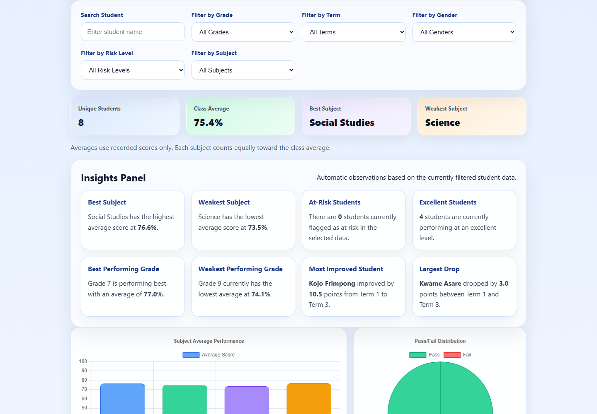
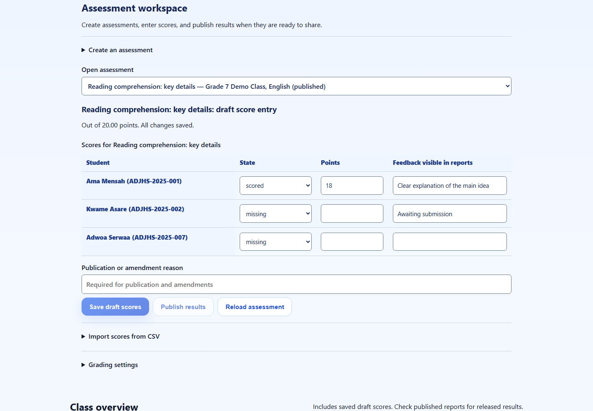
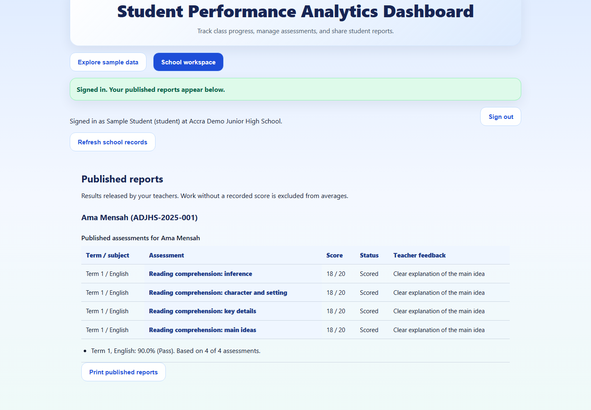

# Student Performance Analytics Dashboard

A school assessment application with a React dashboard, a Fastify API, and PostgreSQL. Teachers enter scores and publish results; students and guardians see reports for their linked student records.

[Open the application](https://student-performance-dashboard-three.vercel.app/) | [Case study](docs/case-study.md) | [Walkthrough](docs/walkthrough.md)

## Try it

Use **Explore sample data** to filter results, compare terms, import spreadsheets, and edit a dataset saved on your device. No account is needed.

Open **School workspace** and choose **Try as teacher**, **Try as student**, or **Try as guardian**. These shortcuts use ordinary password sign-in with the public accounts below. There is no authentication bypass.

| Role | Email | Password | Access |
| --- | --- | --- | --- |
| Teacher | teacher@portfolio.example | TryTeacher2026! | Grade 7 English assessments, draft scores, imports, publication |
| Student | student@portfolio.example | TryStudent2026! | Ama Mensah's published results |
| Guardian | guardian@portfolio.example | TryGuardian2026! | Ama Mensah's published results |

School code: `accra-demo-jhs`. These credentials are intentionally public. This is a shared, fictional school: another visitor's edits may appear. Keep all uploaded records fictional. Administrator credentials are private; administrator features are covered in the workflow guide and tests.

A useful review path:

1. Open the sample dashboard and filter by term or subject.
2. Try the teacher account and create an English assessment for Grade 7. Choose a date within its term.
3. Enter scores, save, and refresh. A recorded zero and missing work remain different.
4. Preview a CSV import. Invalid rows prevent saving; a valid import updates only the listed students.
5. Add a publication reason and publish. Sign out, try the student account, and open the published result.

## Screenshots





[Watch the 58-second walkthrough](docs/assets/school-workflow.mp4).

## What is implemented

- Search, grade/gender/risk/subject/term filters, charts, accessible chart tables, and student details.
- CSV and Excel import/export in the sample dashboard; stable student IDs across terms.
- Password sign-in, expiring cookie sessions, school isolation, and class/subject assignments for teachers.
- Assessment creation, draft score entry, explicit missing/excused/incomplete states, and stale-save rejection.
- Mapped CSV preview and atomic commit in the school workspace, with row errors, expiry, and safe retries.
- Versioned grading rules and immutable publications. Editing a draft leaves released reports unchanged until republished.
- Student and guardian reports limited to explicitly linked students; browser printing.
- Administrator assignment management, invitations, password recovery, account deactivation, and audit history. Account links are delivered manually.

The sample dashboard stores its dataset in localStorage. School records live in PostgreSQL and are not copied into that dataset. Staff overview charts include drafts and use fixed advisory bands; official reports use the grading rules retained with their publication.

## Stack and structure

React 19, Vite, Chart.js, Papa Parse, XLSX, Fastify, TypeScript, Zod, PostgreSQL, and Drizzle. Vercel serves the frontend and same-origin API; Supabase hosts PostgreSQL. New school workflow screens are TypeScript; older dashboard components remain JavaScript.

```text
src/                  React UI, API adapters, sample data, analytics and import/export
apps/api/src/         Sessions, assignments, assessments, reports and database schema
api/index.ts          Vercel function adapter
apps/api/drizzle/     SQL migrations for fresh local databases
supabase/migrations/  Mirrored SQL migrations for the existing hosted installation
tests/e2e/            Desktop/mobile browser workflows and accessibility checks
docs/                 Setup, API, design decisions, case study and release evidence
```

## Run locally

Use Node.js 24 and npm:

```sh
npm ci
npm run dev
```

The sample dashboard works without a database. For the school workspace, follow [database and account setup](docs/local-development.md). Start the API with `npm run api:dev` in another terminal. PostgreSQL 17 or later is supported.

After setting `DATABASE_URL` explicitly to a fictional demo database, `npm run demo:seed` adds the public accounts without resetting academic records or changing existing passwords. Set `VITE_PUBLIC_DEMO=true` before starting/building the frontend to show the sign-in shortcuts. Leave it disabled outside the portfolio demonstration.

Existing Supabase installations must use the Supabase migration history. Do not run an initial Drizzle migration or a database reset against the hosted school.

## Verification

```sh
npm run lint
npm run typecheck
npm test
npm run build
npm run api:build
npm run test:integration
npm run test:e2e -- --project=desktop
npm run test:e2e -- --project=mobile
```

The unit/API suite contains 31 tests. PostgreSQL integration tests cover school isolation, session and assignment checks, competing saves, imports, publications, invitations, recovery, and shared rate-limit counters. Browser tests cover the teacher-to-learner workflow, administrator invitations and assignment changes, sample-data separation, errors/retries, and accessibility at desktop/mobile sizes. Run browser viewports separately with a fresh test API so sign-in budgets remain independent. See [local setup](docs/local-development.md) for the isolated test database and credentials; never run these suites on the hosted database.

GitHub Actions runs lint, type checks, unit/API tests, builds, PostgreSQL integration tests, and desktop/mobile Chromium workflows. The exact local and hosted verification results are recorded in [deployment notes](docs/deployment.md).

## Limits

This project demonstrates a school workflow with fictional records. It has not been evaluated in a live school. Automated account email, PDF generation beyond browser printing, broader school setup, large-school performance measurements, manual screen-reader testing, and non-Chromium browser coverage remain unfinished. Existing dependency advisories, including the XLSX npm package, require remediation before any real-student deployment.

[API reference](docs/api.md) | [Workflow guide](docs/school-workflow.md) | [Architecture decisions](docs/adr/) | [Threat model](docs/threat-model.md)
