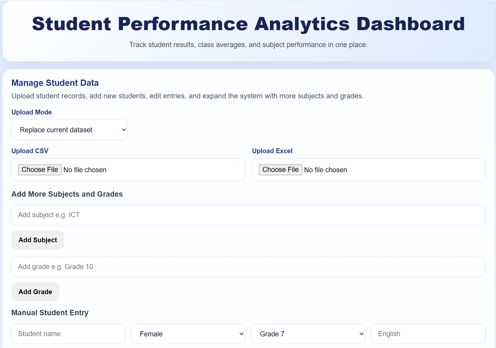
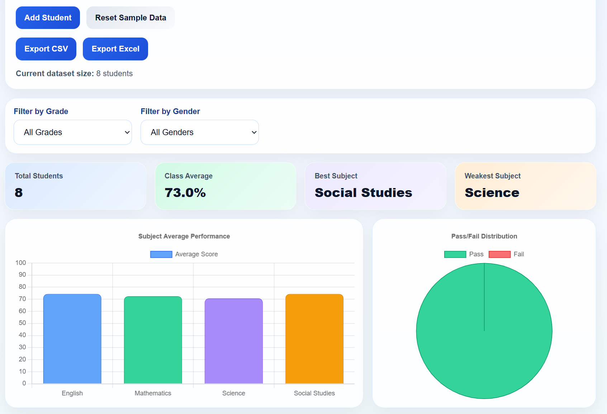
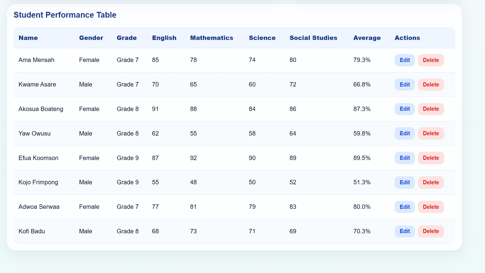

# Student Performance Analytics Dashboard

A portfolio-ready analytics dashboard for tracking student results, surfacing academic risk, and comparing performance across school terms.

## Live Demo

[View Live Project](https://student-performance-dashboard-three.vercel.app/)

## Why This Project Stands Out

This project goes beyond a static chart demo. It supports a realistic school workflow:

- upload CSV and Excel datasets
- manage subjects, grades, and terms dynamically
- review student records in a searchable performance table
- explore class insights and term-over-term trends
- export cleaned data back to CSV or Excel
- persist changes in the browser with `localStorage`

## Portfolio Highlights

- Built with React and Vite using reusable dashboard components
- Includes import, validation, filtering, analytics, export, and modal detail flows
- Tracks multiple academic terms so recruiters can see trend analysis, not just one-off charts
- Ships with sample data and a downloadable CSV template for quick evaluation
- Includes a lightweight test script for analytics utilities

## Screenshots





## Core Features

- Search by student name
- Filter by grade, gender, risk level, subject, and term
- Subject average bar chart
- Pass/fail distribution chart
- Term performance trend chart
- Insight cards for best subject, weakest subject, best grade, weakest grade, and student improvement
- Manual student entry and editing
- CSV and Excel upload support
- CSV template download
- CSV and Excel export
- Accessible student details modal with keyboard close support

## Tech Stack

- React 19
- Vite
- Chart.js
- react-chartjs-2
- Papa Parse
- XLSX
- Fastify API workspace
- PostgreSQL schema and migrations with Drizzle
- ESLint

## Project Structure

```text
src/
  components/      UI sections for filters, charts, tables, modal, and data management
  data/            Sample dataset and display configuration
  utils/           Analytics, filtering, import/export helpers, and tests
```

## Local Development

```bash
npm install
npm run dev
```

## Quality Checks

```bash
npm run lint
npm run test
npm run typecheck
npm run build
```

## Database and access status

The dashboard has two separate modes:

- **Browser sandbox:** editable synthetic data persisted in this browser.
- **Database view:** authenticated, read-only API records kept out of browser storage. API failures show an error and retry action.

Administrators can read their school's records and manage teacher class/subject assignments. Teachers can read only assigned class rosters and subject results. The API uses opaque cookie sessions, scoped queries, CSRF request checks, rate limits, and audit events for assignment/session changes. All demo data must remain synthetic.

See [local setup and checks](docs/local-development.md), [API reference](docs/api.md), and [threat model](docs/threat-model.md). GitHub Actions runs unit, PostgreSQL integration, build, and desktop/mobile browser checks.

## Sample Data Format

Your CSV or Excel file should include:

- `studentId` (reuse the same ID across terms; generated separately for each row when omitted)
- `name`
- `gender`
- `grade`
- `term`
- one column for each subject, such as `English`, `Mathematics`, `Science`, and `Social Studies`

## Scores and student identity

Scores must be finite numbers from 0 to 100, or blank. Blank cells are stored as missing and exported as blank cells. Zero is a recorded score. Invalid CSV or Excel uploads are rejected in full with row-level errors; the current dataset stays unchanged. A student ID can have only one record per term.

Student averages use recorded scores only. Subject averages show the mean of recorded scores for that subject; the class average weights each subject with scores equally. Term and grade averages weight each record with scores equally. Records with no scores show "No scores" and are excluded from pass/fail, risk, and improvement calculations. Adding a subject starts its scores as missing.

Use the same `studentId` for a student's records across terms. Names and grades do not determine identity. The manual entry form accepts an existing student ID or generates a new one; exports preserve that ID. Legacy browser records without a student ID use their existing record ID, so they are not automatically linked across terms. Reimport them with explicit student IDs to link them. Previously saved zeroes cannot be distinguished from blanks that older versions converted to zero.

## Product Thinking Behind It

This dashboard is designed as if it were being handed to a school administrator:

- sample data loads instantly for demo purposes
- user changes persist across refreshes
- uploads can replace the current dataset or append to it
- exports make it easy to move processed data back into spreadsheets
- trend analysis helps identify improvement or decline over time

## Next Improvements

- account invitations and password recovery
- PDF reporting for class summaries
- verify the authenticated API behind a same-origin production proxy
- server-side score entry and result publication
